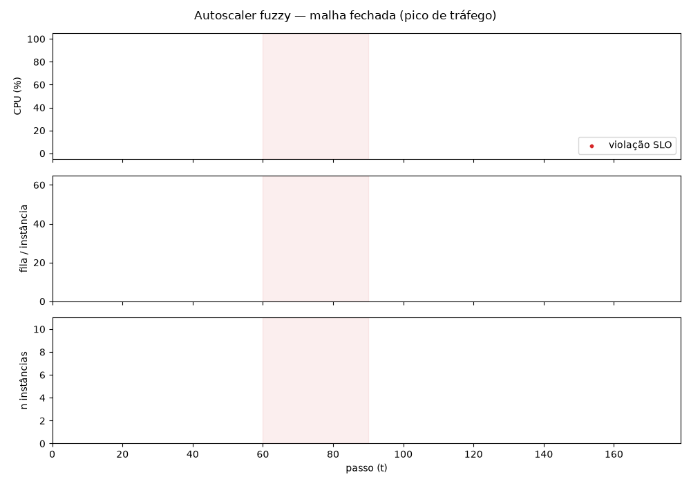
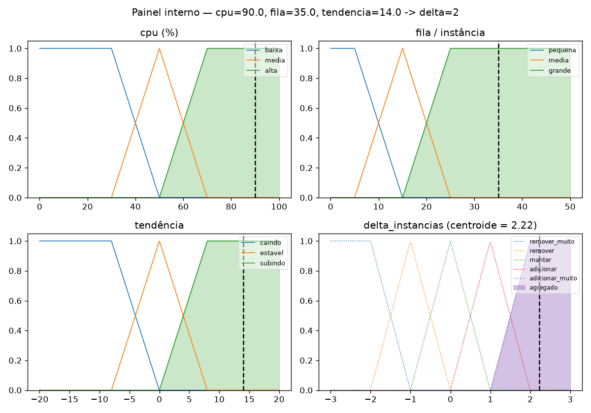

# Autoscaler fuzzy (malha fechada)

> Inteligência Computacional (CESUPA)
> Autor: Gustavo Teixeira Bittencourt de Oliveira



## Sumário

- [Visão geral](#visão-geral)
- [Parte 1 — Teórica](#parte-1--teórica)
  - [1.1 O problema](#11-o-problema)
  - [1.2 Por que lógica fuzzy](#12-por-que-lógica-fuzzy)
  - [1.3 Variáveis linguísticas e conjuntos fuzzy](#13-variáveis-linguísticas-e-conjuntos-fuzzy)
  - [1.4 Base de regras](#14-base-de-regras)
  - [1.5 Inferência Mamdani e defuzzificação](#15-inferência-mamdani-e-defuzzificação)
  - [1.6 Modelo do ambiente (malha fechada)](#16-modelo-do-ambiente-malha-fechada)
  - [1.7 Baselines e métricas de comparação](#17-baselines-e-métricas-de-comparação)
- [Parte 2 — Técnica](#parte-2--técnica)
  - [2.1 Estrutura do projeto](#21-estrutura-do-projeto)
  - [2.2 Como executar](#22-como-executar)
  - [2.3 Painel interno do fuzzy (bônus)](#23-painel-interno-do-fuzzy-bônus)
  - [2.4 Status do desenvolvimento](#24-status-do-desenvolvimento)
  - [2.5 Uso de IA generativa](#25-uso-de-ia-generativa)

## Visão geral

Controlador fuzzy (Mamdani) que decide, a cada passo de tempo, quantas
instâncias de um servidor adicionar ou remover, com base no estado
observado do sistema (uso de CPU, tamanho da fila de requisições por
instância, tendência de curto prazo da carga). O ambiente (fila +
instâncias) evolui segundo um modelo determinístico (dado um seed); o
próximo estado realimenta o controlador no passo seguinte, formando a
malha fechada. Dois baselines (if/else por limiar de CPU, estilo
Kubernetes HPA, e PID) servem de referência para comparação.

Documentação complementar: [`docs/SPEC.md`](docs/SPEC.md) (especificação
completa) e [`docs/DECISOES.md`](docs/DECISOES.md) (decisões de modelagem
e perguntas prováveis de apresentação).

---

# Parte 1 — Teórica

## 1.1 O problema

Controlar, a cada passo de tempo discreto, o número de instâncias `n(t)`
de um servidor para manter a fila de requisições sob controle e a CPU numa
faixa saudável, reagindo também à tendência de curto prazo da carga. É um
problema clássico de *autoscaling* em nuvem: poucas instâncias violam o
SLO (fila longa, latência alta); instâncias demais custam dinheiro.

O desafio é agravado pelo **atraso de provisionamento**: uma instância
nova leva alguns passos para entrar em operação, então é preciso antecipar
a carga em vez de apenas reagir a ela.

## 1.2 Por que lógica fuzzy

A decisão "quantas instâncias adicionar" depende de limiares difusos e da
combinação de 3 variáveis correlacionadas (CPU, fila, tendência). Não há
um limiar único que separe "ok" de "sobrecarregado": a transição é
gradual, e o operador humano raciocina em termos como *"CPU meio alta, mas
a fila está caindo, então espera"*.

- **PID puro** enxerga apenas uma variável de erro.
- **Limiares if/else rígidos** oscilam nas bordas (CPU 69% vs 71% gera
  decisões opostas).
- **Regras linguísticas (Mamdani)** capturam o raciocínio combinado das
  três entradas com transições suaves.

## 1.3 Variáveis linguísticas e conjuntos fuzzy

**Entradas**

| Variável | Domínio | Unidade | Conjuntos (forma) |
|---|---|---|---|
| `cpu` | [0, 100] | % de utilização média | baixa (trapézio 0/0/30/50), média (triângulo 30/50/70), alta (trapézio 50/70/100/100) |
| `fila` | [0, 50] | requisições em espera **por instância** (`q/n`) | pequena (trapézio 0/0/5/15), média (triângulo 5/15/25), grande (trapézio 15/25/50/50) |
| `tendencia` | [-20, 20] | variação suavizada (EMA) da taxa de chegada, req/passo | caindo (trapézio -20/-20/-8/0), estável (triângulo -8/0/8), subindo (trapézio 0/8/20/20) |

**Saída**

| Variável | Domínio | Unidade | Conjuntos (forma) |
|---|---|---|---|
| `delta_instancias` | [-3, 3] | instâncias (arredondado após o centroide) | remover_muito (trapézio -3/-3/-2/-1), remover (triângulo -2/-1/0), manter (triângulo -1/0/1), adicionar (triângulo 0/1/2), adicionar_muito (trapézio 1/2/3/3) |

Justificativas de modelagem:

- **Formas:** extremos em trapézio (saturam no limite do domínio: "muito
  alto" não fica mais alto além de um ponto); meio em triângulo (pico
  único, pois "médio"/"estável" é uma faixa estreita de equilíbrio).
- **Limites:** seguem a prática de autoscaling (setpoint de CPU em
  60–70%) e foram ajustados observando a faixa real produzida pelo
  ambiente simulado, não escolhidos a priori.
- **Fila normalizada por instância (`q/n`):** 100 requisições atrás de 10
  instâncias é bem diferente de 100 atrás de 2; a normalização torna o
  critério independente da escala atual do sistema.

## 1.4 Base de regras

27 regras (3×3×3) construídas por um critério explícito e verificável, não
"no olho", garantindo coerência e ausência de buracos:

```
score = nivel(cpu) + nivel(fila) + nivel(tendencia)   # cada nível em {-1, 0, +1}
score <= -2  -> remover_muito
score == -1  -> remover
score ==  0  -> manter
score ==  1  -> adicionar
score >=  2  -> adicionar_muito
```

`nivel` é -1 para o conjunto "baixo" (baixa/pequena/caindo), 0 para o
"médio" (média/média/estável) e +1 para o "alto" (alta/grande/subindo).
Regras-chave:

| Antecedente | Consequente | Intuição |
|---|---|---|
| `cpu=alta, fila=grande, tendencia=subindo` | adicionar_muito | pico claro, reação máxima |
| `cpu=baixa, fila=pequena, tendencia=caindo` | remover_muito | ociosidade clara, economiza custo |
| `cpu=alta, fila=pequena, tendencia=caindo` | remover | evita oscilação: CPU alta momentânea, fila vazia e carga já caindo |
| `cpu=média, fila=média, tendencia=estável` | manter | ponto de equilíbrio |

## 1.5 Inferência Mamdani e defuzzificação

Etapas a cada passo de tempo:

1. **Fuzzificação:** cada entrada nítida recebe um grau de pertinência em
   cada conjunto da sua variável.
2. **Avaliação das regras:** o antecedente de cada regra combina os graus
   (operador E = mínimo) e define a força de disparo.
3. **Agregação:** os conjuntos de saída recortados pela força de cada
   regra são unidos (máximo).
4. **Defuzzificação por centroide:** o centro de gravidade do conjunto
   agregado vira o valor nítido de `delta_instancias`, arredondado para
   inteiro.

**Por que Mamdani e não Sugeno?** As regras são linguísticas e simétricas
nas 3 entradas, e a saída precisa ser interpretável/inspecionável no
painel interno; Sugeno daria uma saída numérica direta por regra,
perdendo a legibilidade do conjunto agregado.

**Por que centroide?** É a defuzzificação mais suave: pequenas variações
nas entradas mudam a saída continuamente, evitando saltos bruscos de `n`
e dando uma função objetivo mais bem comportada para uma futura
otimização (NSGA-II).

## 1.6 Modelo do ambiente (malha fechada)

Passos discretos `t = 0, 1, 2, ...`:

- `capacidade`: 10 requisições atendidas por instância por passo;
  `n_min = 1`, `n_max = 10`.
- `chegadas(t) = base + amplitude * sin(2π t / periodo) + Poisson(ruido) [+ pico(t)]`
  — carga "dia/noite" (`base=30`, `amplitude=15`, `periodo=100`), ruído
  Poisson e pico de tráfego configurável.
- `atendidas(t) = min(q(t) + chegadas(t), n(t) * capacidade)`
- `q(t+1) = max(0, q(t) + chegadas(t) - n(t) * capacidade)`
- `cpu(t) = min(100, 100 * atendidas(t) / (n(t) * capacidade))`
- `tendencia(t)`: EMA de `chegadas` (`alpha=0.3`) menos a EMA no passo
  anterior.
- **Atraso de provisionamento:** aumentos de `n` só valem `k=3` passos
  após a decisão; reduções são imediatas. É esse atraso que torna o
  controle não-trivial: reagir tarde custa SLO, reagir forte demais com
  antecedência custa dinheiro.
- **SLO:** espera estimada `q(t) / (n(t) * capacidade)` acima de
  `limite_slo = 2.0` passos conta como violação.

## 1.7 Baselines e métricas de comparação

Controladores comparados (mesma interface `decidir(observacao) -> delta`):

1. **Fuzzy Mamdani** (este projeto)
2. **if/else por limiar** (estilo Kubernetes HPA: compara a CPU a limites
   fixos)
3. **PID** sobre o erro `setpoint_cpu − cpu(t)` (setpoint 65%)

Métricas (`metrics.py`):

| Métrica | Significado |
|---|---|
| `pct_violacao_slo` | % de passos com violação de SLO |
| `custo` | soma de `n(t)` na simulação (proxy de instância×tempo) |
| `fila_maxima` | pico de `q(t)` |
| `num_mudancas_escala` | passos com `delta != 0` (proxy de oscilação) |
| `tempo_recuperacao` | passos entre o fim do pico e a CPU ficar abaixo do setpoint por 5 passos consecutivos |

---

# Parte 2 — Técnica

## 2.1 Estrutura do projeto

```
fuzzy-autoscaler/
├── README.md
├── AI_USAGE_LOG.md
├── requirements.txt
├── src/
│   ├── fuzzy_controller.py     # variáveis, regras, inferência
│   ├── environment.py          # dinâmica do ambiente (fila/instâncias)
│   ├── simulation.py           # loop de realimentação
│   ├── baselines.py            # controladores if/else e PID
│   ├── metrics.py              # métricas de desempenho
│   └── viz/
│       ├── realtime.py         # animação em tempo real
│       └── inner_panel.py      # painel interno do fuzzy (pertinências etc.)
├── notebooks/
│   └── projeto_fuzzy.ipynb
├── tests/
├── docs/                        # figuras, GIF, vídeo
└── outputs/                     # saídas geradas (não versionadas)
```

## 2.2 Como executar

```bash
python3 -m venv .venv
source .venv/bin/activate
pip install -r requirements.txt
```

Rodar a suíte de testes (a partir da raiz do projeto):

```bash
pytest
```

Abrir o notebook final (já executado, com os resultados salvos — basta
abrir para ler, ou rodar `Kernel > Restart & Run All` para reproduzir):

```bash
jupyter notebook notebooks/projeto_fuzzy.ipynb
```

Usar os módulos diretamente em um script/REPL (a partir da raiz, com
`src/` no `PYTHONPATH` — é o que `conftest.py` já faz para os testes e a
primeira célula do notebook faz via `sys.path.insert`):

```python
from environment import ConfigAmbiente
from fuzzy_controller import controlador_padrao
from simulation import simular, plotar_evolucao

cfg = ConfigAmbiente(pico_inicio=80, pico_duracao=30, pico_amplitude=60.0)
resultado = simular(controlador_padrao(), config=cfg, seed=0, passos=200)
plotar_evolucao(resultado, config=cfg, titulo="exemplo").savefig("outputs/evolucao.png")
```

Gerar o GIF de demonstração e os painéis internos em `docs/` (os arquivos
já versionados foram gerados assim):

```python
from environment import ConfigAmbiente
from fuzzy_controller import controlador_padrao
from viz.inner_panel import figura_painel_interno
from viz.realtime import gerar_gif_demo

cfg = ConfigAmbiente(pico_inicio=60, pico_duracao=30, pico_amplitude=60.0)
gerar_gif_demo(controlador_padrao(), config=cfg, seed=1, passos=180, salvar_em="docs/demo_malha_fechada.gif")
figura_painel_interno(controlador_padrao(), {"cpu": 90.0, "fila": 35.0, "tendencia": 14.0},
                      salvar_em="docs/painel_interno_pico.png")
```

## 2.3 Painel interno do fuzzy (bônus)

`src/viz/inner_panel.py` reconstrói a inferência Mamdani passo a passo
(graus de pertinência de cada entrada, regras disparadas, conjunto
agregado de saída e centroide) para uma observação específica — útil para
inspecionar/explicar uma decisão do controlador. Exemplo com tráfego em
pico (`cpu=90`, `fila=35`, `tendencia=14`, decide `+2`):



## 2.4 Status do desenvolvimento

- [x] Fase 0 — Estrutura do projeto, ambiente e dependências
- [x] Fase 1 — Controlador fuzzy Mamdani (`fuzzy_controller.py`) e testes
- [x] Fase 2 — Modelo do ambiente (`environment.py`) e testes
- [x] Fase 3 — Loop de malha fechada (`simulation.py`) e gráficos estáticos
- [x] Fase 4 — Baselines (if/else, PID) e tabela comparativa (`baselines.py`, `metrics.py`)
- [x] Fase 5 — Visualização em tempo real (`viz/realtime.py`) e painel interno do fuzzy (`viz/inner_panel.py`) (bônus)
- [x] Fase 6 — Notebook final (`notebooks/projeto_fuzzy.ipynb`)
- [x] Fase 7 — README completo e declaração de IA (vídeo de demonstração: gravação pendente pelo autor)

## 2.5 Uso de IA generativa

Este projeto foi desenvolvido com apoio de IA generativa (Claude Code) em
papel par de programação, além de estar testando o modo de implementação do Spec-Driven-Development (SDD). Detalhes de uso sessão a sessão estão em [`AI_USAGE_LOG.md`](AI_USAGE_LOG.md); a declaração formal consta no
início do notebook final.
